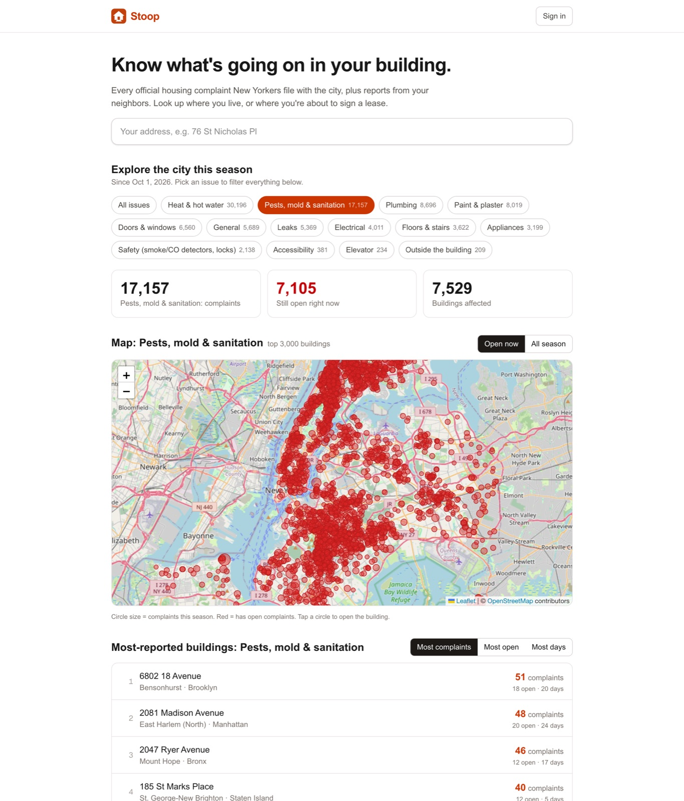
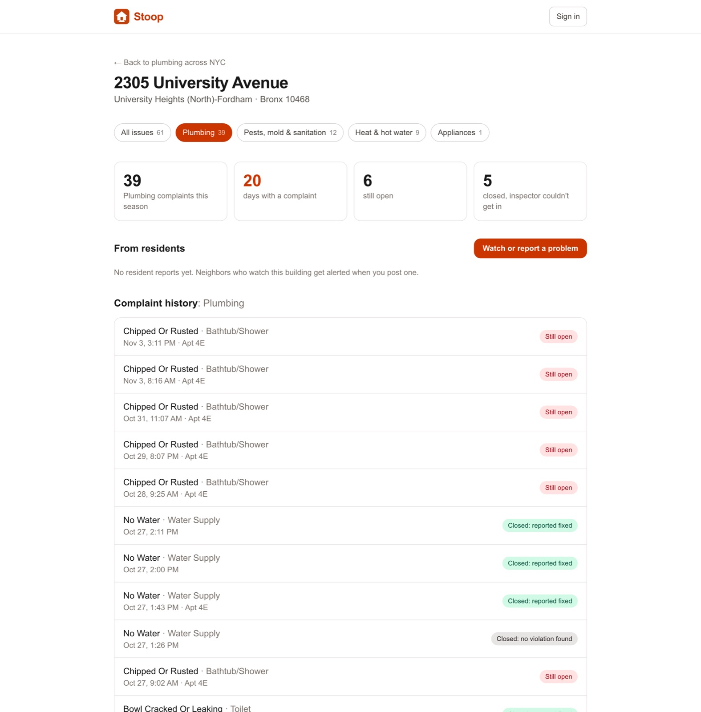
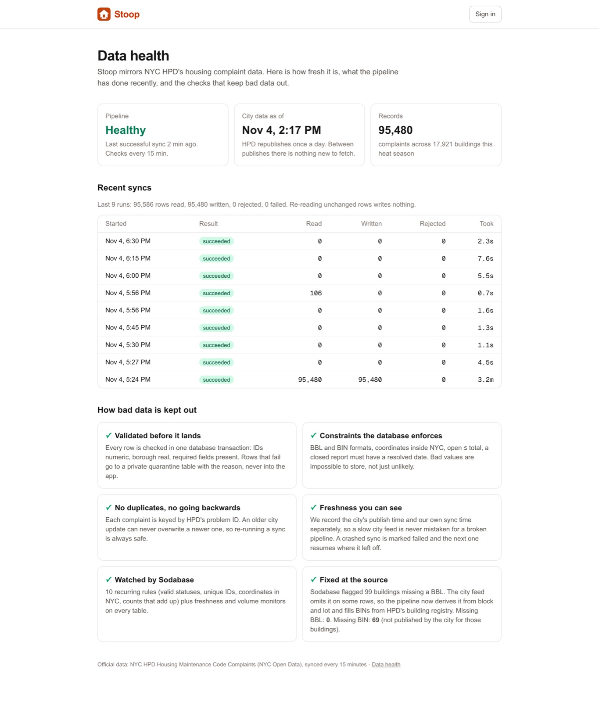
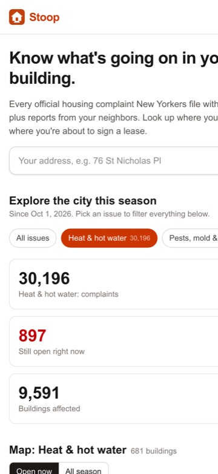

# Stoop

**Know what's going on in your building.** Every official NYC housing complaint about your building, how each one was actually closed, and reports from your neighbors, with live alerts when something changes.

- **Live app:** https://stoop-livid.vercel.app
- **Data health:** https://stoop-livid.vercel.app/status
- Built at the Supabase × Sodabase × BuilderBase NYC Hackathon, Nov 4 2026.



| Building page, filtered to one issue | Data health (`/status`) | Phone |
|---|---|---|
|  |  |  |

## The problem

In the past 12 months New Yorkers filed **999,691 complaints** with the city's housing agency (HPD) about **65,104 buildings**: no heat, mold and rats, leaks, broken plumbing, peeling lead paint, broken locks, dead elevators. The city publishes all of it as open data, but it's scattered, hard to search, and "closed" often doesn't mean fixed: thousands are closed because the inspector couldn't get in. Tenants and renters can't easily answer: *is my building a problem, and is anything being done?*

## What it does

- **Search any address** (fuzzy: "1040b e 217") and see every HPD complaint since Oct 1 across 14 issue types, filtered to the one you care about, with the real outcome of each.
- **Explore the city by issue:** 14 categories (heat, pests and mold, leaks, plumbing, paint/lead, locks, elevators…), a live map, and a leaderboard sortable by most complaints, most still open, or most days with a complaint.
- **Watch buildings** you live in or are about to rent. A bell alerts you live when a new complaint lands, when one is closed (and how), or when a neighbor posts.
- **Resident reports:** neighbors can flag problems the city hasn't caught yet (labelled unverified).

## Architecture

```
NYC Open Data (HPD complaints, daily)        HPD building registry
            │                                         │
   pg_cron every 15 min ──► Edge Function ingest-hpd ─┘
   (secret in Vault)              │  pages of 2,000 rows after the saved position
                                  ▼
          ingest_hpd_batch()  ── one transaction per page ──
          validate → quarantine rejects → upsert buildings (only if changed)
          → upsert complaints (only newer city updates)
          → refresh building_stats (changed buildings) → triggers fan out alerts
          → save position
                                  │
              Postgres (RLS on every table) ── Realtime ──► Next.js on Vercel
                                                            (Auth: magic link + guest)
```

| Supabase feature | Used for |
|---|---|
| Postgres schema | enums, FKs, CHECK constraints, generated columns (heat season, normalized address) |
| Indexes | trigram (fuzzy address search), partial (open complaints), composite (building+time, season+category) |
| Row-level security | all 11 tables; official data writable only by the service-role ingest; user rows scoped to `auth.uid()`; column-level grants |
| Functions / RPC | `search_buildings`, `category_summary`, `top_buildings`, `map_buildings`, `ingest_hpd_batch` |
| Triggers | statement-level with transition tables: one set-based alert insert per ingest batch |
| Edge Functions | `ingest-hpd`: fetch, forward, enrich BIN/BBL from the HPD registry |
| Cron + Vault | `pg_cron` + `pg_net` every 15 min; shared secret stored in Vault |
| Realtime | live alert bell and live neighbor reports (RLS-filtered) |
| Auth | magic link + anonymous guest sign-in |

## Data quality

1. **Validate before it lands.** Bad rows go to a private `ingest_rejects` quarantine with the reason, never into app tables.
2. **Constraints the database enforces:** BBL/BIN formats, coordinates inside NYC, counts that add up, resolved reports have a resolved date.
3. **Idempotent and monotonic.** Keyed by HPD `problem_id`; an older city update can never overwrite a newer one. Re-running a sync writes nothing.
4. **Freshness controls.** City publish time and our sync time are stored separately and shown in the app. HPD stamps each daily batch with one timestamp, so each page saves a position of (`:updated_at`, Socrata `:id`) in the same transaction as its rows, and the next sync continues right after it. A big batch is worked through over several runs (`partial`) instead of having to fit in one. City API errors are retried, and an outage is recorded as `upstream_down`, not as our failure. `/status` shows each data source as healthy, catching up, city API down, failing, or stalled.
5. **Sodabase** watches all 10 tables (freshness + volume) plus 10 recurring rules.
6. **Fixed at the source.** Sodabase flagged 99 buildings missing BBL. Root cause: the city feed omits it on some rows. The ingest now derives BBL from block and lot and fills BIN from HPD's registry: missing BBL 99 → 0, BIN 98 → 69. A closer look found 161 more buildings holding NYC's placeholder BINs (1000000 … 5000000, "none assigned"), which also blocked the registry fill. Placeholders are now treated as missing and kept out by a constraint: buildings without a real BIN 230 → 86 (not published by the city at all).

## Repo layout

```
supabase/migrations/        schema, RLS, ingest, cron, explore RPCs (applied in order)
supabase/functions/ingest-hpd/   the sync edge function
scripts/backfill.py         one-off season backfill through the same SQL path
web/                        Next.js 15 app (App Router, @supabase/ssr, Leaflet)
```

## Running locally

```bash
cd web
cp ../.env.example .env.local   # fill NEXT_PUBLIC_SUPABASE_URL and NEXT_PUBLIC_SUPABASE_PUBLISHABLE_KEY
npm install
npm run dev
```

## Deploying

The Vercel project's Root Directory is `web/`, so every push and PR gets a preview build. Production goes out from the repo root (`.vercelignore` uploads only `web/`):

```bash
vercel deploy --prod --yes
```

Database migrations and the `ingest-hpd` function are deployed separately with the Supabase CLI.

Data: NYC HPD via NYC Open Data. Map tiles © OpenStreetMap contributors.
